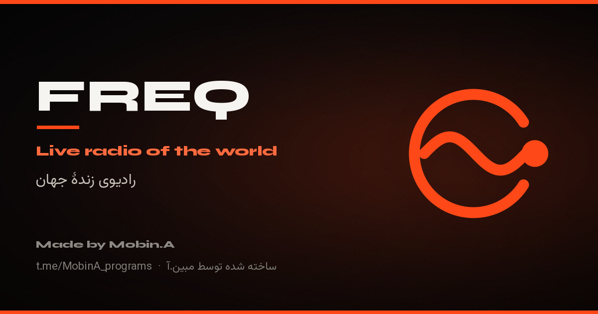

<div align="center">

# FREQ

**Live radio of the world — رادیوی زندهٔ جهان**

Thousands of stations, a world map, car mode, sleep timer, folders, 50 themes,
11 player styles, full Persian/English UI and an offline-first PWA shell.

[**Open the app →**](https://pillow1243.github.io/freq/)



[](https://github.com/Pillow1243/freq/actions/workflows/pages.yml)
[](https://github.com/Pillow1243/freq/actions/workflows/ci.yml)


</div>

---

## Why FREQ

- **No build step.** Plain HTML, CSS and JavaScript served straight from GitHub Pages.
- **Fast by default.** Code-split helpers, incremental list rendering, lazy artwork,
  `content-visibility` cards, canvas FX capped at 2× DPR and paused in background tabs.
- **Offline-first, honestly.** A real service worker precaches the shell and keeps the
  last station snapshot. A directory outage is never dressed up as “you are offline”:
  the banner says which of the two happened, retries with backoff and keeps your saved
  stations on screen.
- **Accessible.** Skip link, focus traps and focus restore for every dialog, ARIA state
  on toggles, live regions for playback and counts, reduced-motion and high-contrast modes.
- **Bilingual.** Persian (RTL, Jalali date) and English (LTR), switchable at runtime.
- **Audio that never goes silent.** Effects (EQ, normalisation) run on a second media
  element that is the only one fetched with CORS; a stream that refuses CORS is remembered
  and replayed on the plain element instead of being muted or marked broken.
- **Private.** No accounts, no trackers, no cookies. Everything personal lives in
  `localStorage`; only Radio Browser and Open-Meteo see requests.

## Features

| Listen | Organise | Interface |
| --- | --- | --- |
| 120-station pages with infinite scroll | Favourites (200) and recents (40) | 50 hand-tuned themes, 11 player styles |
| Smart search: name, tag, country, **city**, language and HD filters | Six presets (tap to play, hold to save) | Persian / English, Jalali dates |
| Playable-only filter (skips HLS/http-only streams) | Per-station stream health + **report broken** | Smart status bar: offline vs. unreachable vs. rate-limited |
| Near-me and random discovery | Folders | Stage view, vinyl, VU meters, tuner |
| World map (click a dot to play) | Versioned JSON backup/export/import | Car mode, night clock, sleep timer |
| Scan mode and auto-skip on dead streams | Listening statistics | Alarm, Media Session, keyboard shortcuts |
| Stream fallback (`url_resolved` → `url`) | Copy link, native share, Telegram | Installable PWA + update prompt |
| 6-band equalizer + loudness normalisation | Settings backup covers EQ and trims | `E` opens the EQ from anywhere |

### Keyboard shortcuts

`Space` play/pause · `N`/`P` next/prev · `R` random · `F` favourite · `S` share ·
`/` search · `1`–`6` presets · `Shift+1`–`6` save preset · `M` map · `V` car ·
`C` clock · `K` scan · `T` themes · `Y` stats · `H` near me · `E` equalizer · `?` help · `Esc` close layer.

## Project layout

```
index.html              app shell, SEO/OG/JSON-LD, CSP
styles.css              design system + responsive + a11y media queries
core.js                 pure helpers (UMD): URL safety, normalisation, filters, Jalali…
i18n.js                 fa/en dictionaries + first-visit language detection
app.js                  UI, player engine, layers, canvas FX, PWA wiring
sw.js                   precache + stale-while-revalidate/network-first strategies
manifest.webmanifest    installability, shortcuts, icons
assets/                 icons + social card
scripts/dev-server.mjs  zero-dependency local server with correct MIME types
scripts/check.mjs       static integrity checks (ids, i18n, CSP hash, assets…)
tests/                  node:test unit + jsdom boot/interaction tests
docs/CHECKLIST-STATUS.md product/technical checklist mapped to code
server.py               tiny Python fallback server
```

## Architecture notes

`core.js` is the only shared module. It works as `<script>` (`window.FreqCore`) and as
CommonJS (`require("./core.js")`), which is what the test suite exercises. It never
touches the DOM, so every parser, sanitiser and URL builder can be unit-tested in Node.

`app.js` is a single IIFE with four internal layers:

1. **Data** — `getJSON()` with an in-memory TTL cache, host failover across four
   Radio Browser mirrors, abortable requests and offline detection.
2. **State** — one object, mirrored to `localStorage` under `freq-*` keys.
3. **Renderers** — pure-ish functions that rebuild their own region and keep
   `aria-*` state in sync. The station list only appends new cards when the result set
   is a strict extension of the previous one.
4. **Wiring** — one delegated `data-act` click handler, one keyboard handler, one
   audio event set and a 1-second clock/stat tick.

Dialogs use a shared layer stack (`pushLayer`/`dropLayer`): it traps Tab, restores focus,
integrates with the Android back button and closes through `Escape`.

## Local development

```bash
# optional: run the checks and tests
npm install
npm run verify           # check + lint + node:test (unit & jsdom)

# serve (no dependencies required)
npm run dev              # http://localhost:4176
# or
python3 server.py
```

`npm run dev` serves with `no-store`, sets `Service-Worker-Allowed`, correct MIME types
and a small request log. Any static server works — there is no bundler.

### Useful scripts

| Script | What it does |
| --- | --- |
| `npm run check` | IDs, missing assets, i18n parity & duplicates, dead `data-act`s, CSP hash, version lockstep, manifest, SW precache |
| `npm run lint` | ESLint 9 flat config for browser + Node globals |
| `npm test` | `node --test` — 76 unit + jsdom integration tests |
| `npm run verify` | all of the above |
| `npm run serve:py` | the original Python server |

## Deployment

Push to `main`. GitHub Actions runs the quality gate and publishes a staged `_site/`
folder to Pages. No environment variables or secrets are required.

The service worker uses a versioned cache (`freq-v2.2.0`). Bump `CACHE_VERSION` in
`sw.js` and the `?v=` query string on assets when changing the shell; the app offers a
“Refresh” toast when a new worker is waiting.

## Data sources

- [Radio Browser](https://www.radio-browser.info/) — station directory, votes, clicks.
- [Open-Meteo](https://open-meteo.com/) — optional local weather in the night clock.
- [Google Fonts](https://fonts.google.com/) — Vazirmatn, Syne, IBM Plex Mono.

FREQ is not affiliated with any broadcaster. Station logos and stream URLs belong to
their respective owners.

## Contributing

Small, dependency-free changes are welcome. Please:

1. Keep `node --check` clean for every JS file.
2. Run `npm run verify` before opening a PR.
3. Add user-facing strings to **both** `fa` and `en` in `i18n.js`.
4. If you edit the JSON-LD block in `index.html`, recompute the CSP hash
   (`npm run check` tells you the exact value).

## License

Code © Mobin.A. All rights reserved. The FREQ name, artwork and icons may not be
reused without permission. Third-party libraries and data keep their own licenses.
